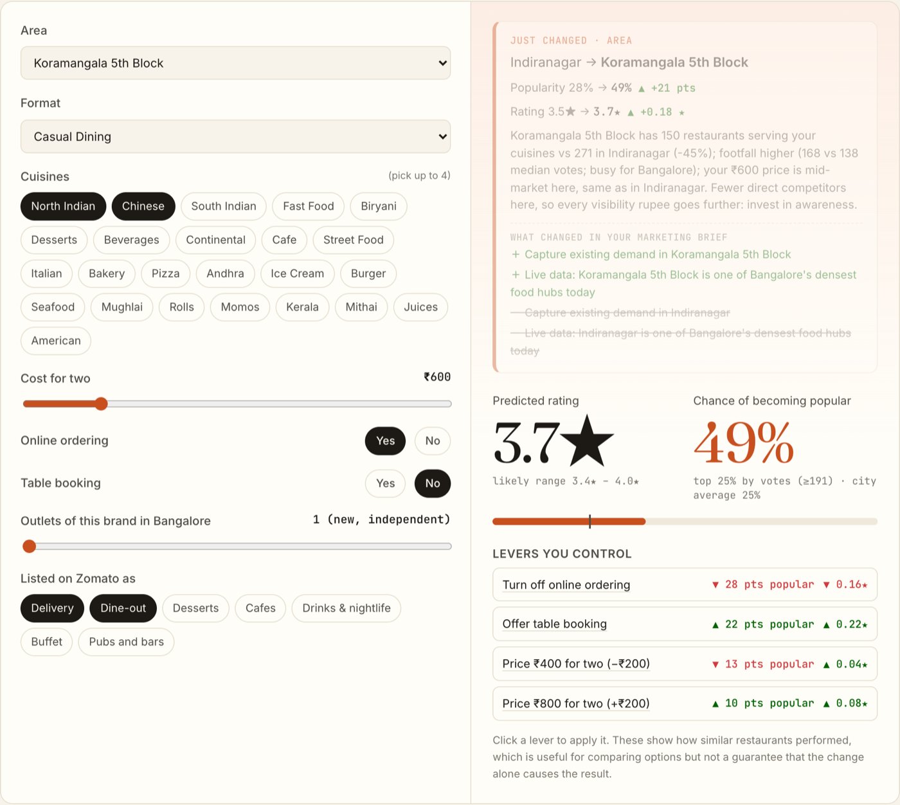
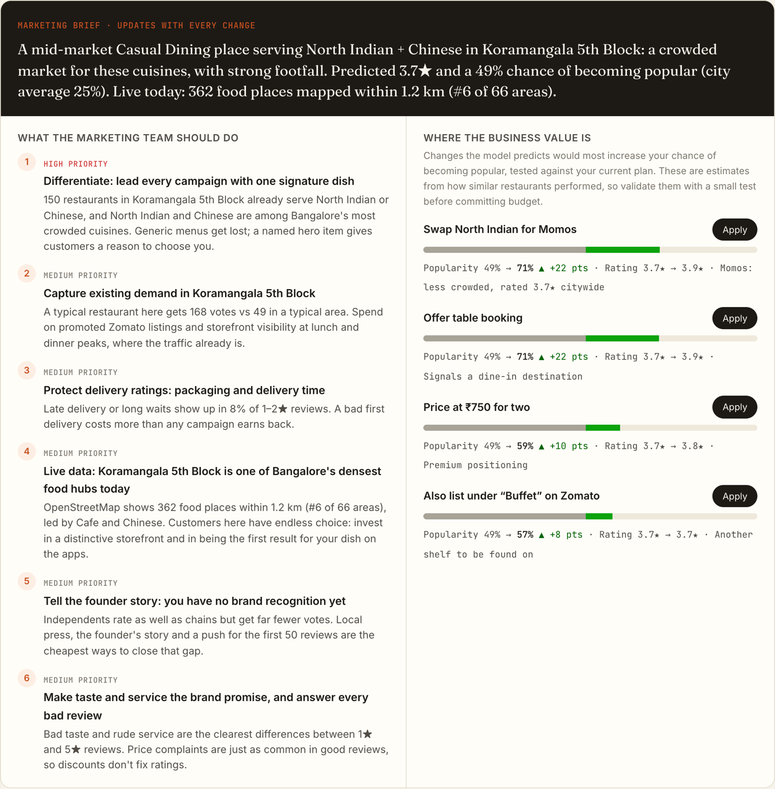

# LaunchLab Bangalore

**Planning a restaurant in Bangalore? Describe the concept and get a predicted Zomato rating, the chance of becoming popular, and a marketing brief that tells the team what to do and where the business value is. All of it updates live with every choice.**

**Live:** https://launchlab-bangalore.vercel.app



## What it does
1. **Predicts** a new restaurant's rating and its chance of reaching the top 25% by votes, from decisions an owner makes before opening: area, cuisines, format, price, delivery, table booking, chain size and Zomato categories.
2. **Writes a marketing brief** for the current concept:
   - *What the marketing team should do:* prioritized actions, each backed by a number.
   - *Where the business value is:* the model tests alternatives (price, area, cuisine mix, categories, booking) and shows the biggest gains, each with one-click **Apply**.
3. **Explains every change.** Switch an option and a banner shows how the predictions moved, why in business terms, and which marketing actions were added or dropped.
4. **Gives market context per option.** Each option has a card with real figures: local competition and gaps, footfall, a price ladder for the area, what unhappy customers of *your* cuisine complain about, and a "marketing move."
5. **Adds a live layer.** Today's food places from **OpenStreetMap** show how dense each area is right now, refreshed automatically twice a week.



## Data
| Source | What | Freshness |
|---|---|---|
| [Zomato Bangalore Restaurants](https://www.kaggle.com/datasets/himanshupoddar/zomato-bangalore-restaurants) (Kaggle) | 12,430 restaurants in 93 areas, 1,25,908 customer reviews | 2019 snapshot |
| [OpenStreetMap](https://www.openstreetmap.org/copyright) via Overpass API | ~7,000 food places mapped today, counted within 1.2 km of each area's centre | Refreshed Mon & Thu by GitHub Actions |

The two sources measure different things (Zomato delivery zones vs a 1.2 km radius; OpenStreetMap is volunteer-mapped), so the site never presents them as "then vs now."

## The models
| Prediction | Model | Accuracy on restaurants it never saw |
|---|---|---|
| **Popularity** (top 25% by votes) | Gradient-boosted trees | **AUC 0.82** (logistic regression 0.81) |
| **Rating** | Gradient-boosted trees | **±0.29★** typical error, 83% within ±0.5★ (area average: ±0.33★) |

- **No leakage:** votes, reviews and "dishes liked" happen after launch, so they're never inputs.
- **Honest testing:** 5-fold cross-validation grouped by brand, so every outlet of a chain lands in the same fold and the model can't remember a sibling branch.
- **Runs in the browser:** the exported trees are checked against scikit-learn's predictions in the pipeline.

**Key takeaway:** concept and location predict *popularity* well, but *rating* only modestly. Ratings come mostly from execution (taste, service), which is why the review analysis matters.

## Findings
- ₹1,500+ places average **4.14★** and 424 median votes; under ₹300: 3.55★ and 23 votes.
- **Online ordering** goes with **2–3× more votes at every price level** (association, not proven cause).
- Chinese, Biryani, Rolls and Andhra are crowded and rate below average; Mediterranean, European and Asian rate highest.
- Chains don't rate higher (3.6★ at every size); they just get more votes.
- Reviews: "bad taste" appears in 11.6% of 1–2★ reviews vs 0.8% of 4–5★. Complaints differ by cuisine: unhappy **pizza** customers mention cold food **2.1×** more than average, **biryani** customers mention small quantity 1.26× more, and **café** customers mention overpriced 2× more.

## How it's built
```
analysis/clean.py     raw Zomato CSV → one row per restaurant + parsed reviews
analysis/insights.py  market stats, cuisine × price, review themes per cuisine/format
analysis/model.py     rating + popularity models, grouped CV, export for the browser
analysis/osm.py       OpenStreetMap fetch (4 tiles, stale-mirror check), geocoding, per-area counts
web/                  React + TypeScript + Vite static site: predictions, brief and insights run client-side
.github/workflows/    twice-weekly live refresh → commit → Vercel redeploys
```

```bash
python3 -m venv .venv && .venv/bin/pip install -r requirements.txt
# data/raw/zomato.csv from kagglehub.dataset_download("himanshupoddar/zomato-bangalore-restaurants")
.venv/bin/python -I analysis/clean.py
.venv/bin/python -I analysis/pipeline.py    # insights + models → web/public/data/
.venv/bin/python -I analysis/osm.py         # live layer → web/public/data/osm.json
cd web && npm install && npm run dev
```

## Limitations
Correlational data, no experiments, so "levers" show how similar restaurants performed, not guaranteed effects. Votes also grow with restaurant age (no opening dates in the data). The models use a 2019 snapshot. OpenStreetMap coverage is incomplete (~45% of places carry a cuisine tag).

**Next step:** the Google Places API for live ratings and new openings, and retraining on fresh data.

*Independent student project, not affiliated with Zomato. Map data © OpenStreetMap contributors, ODbL.*
